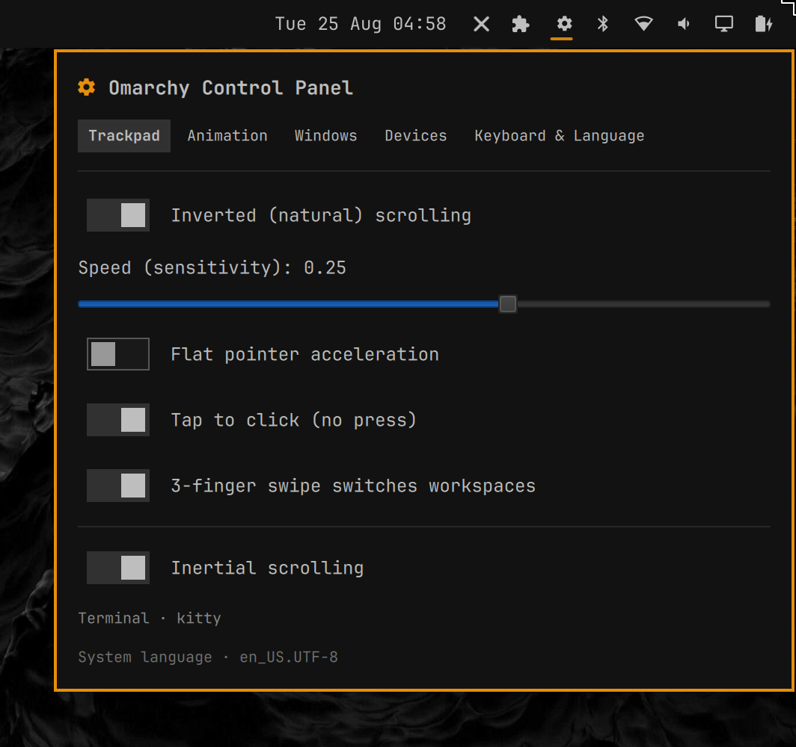
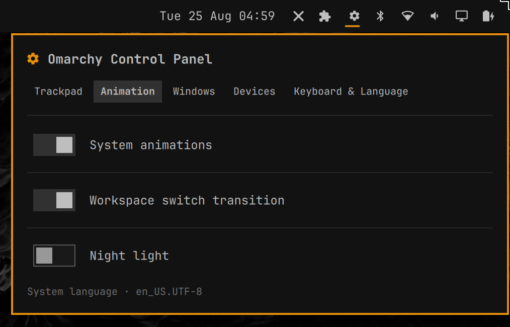
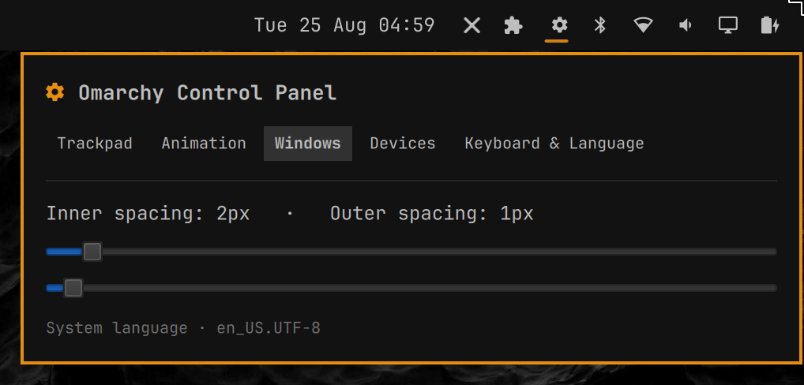
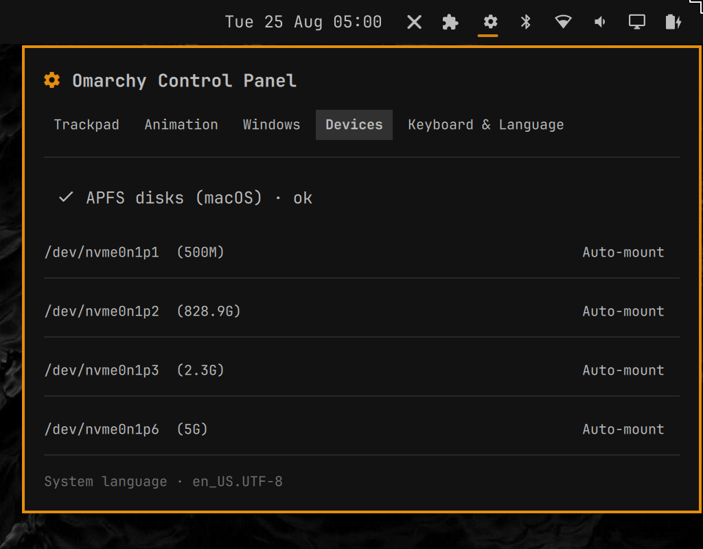
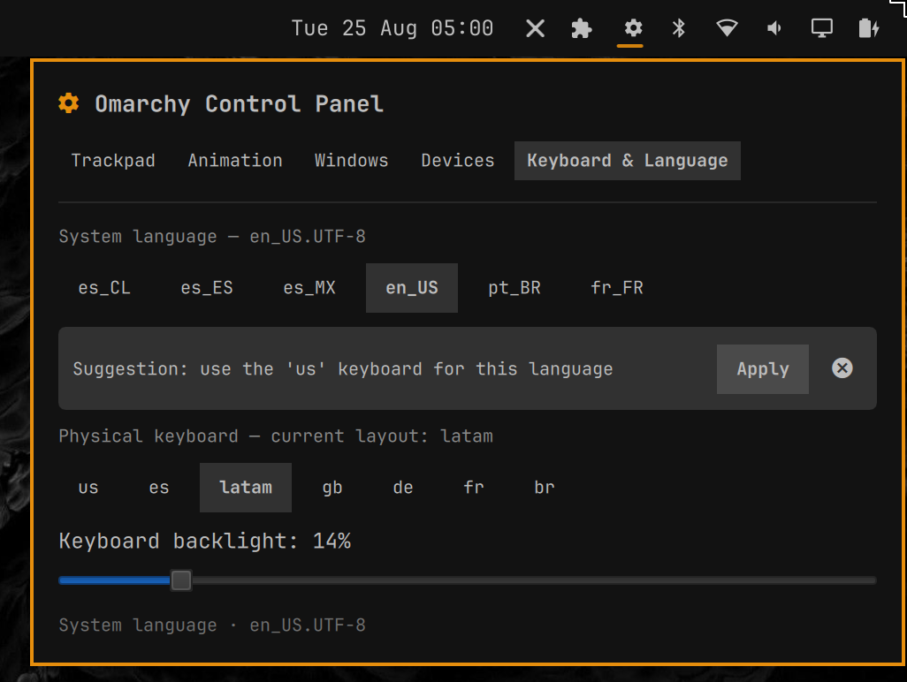
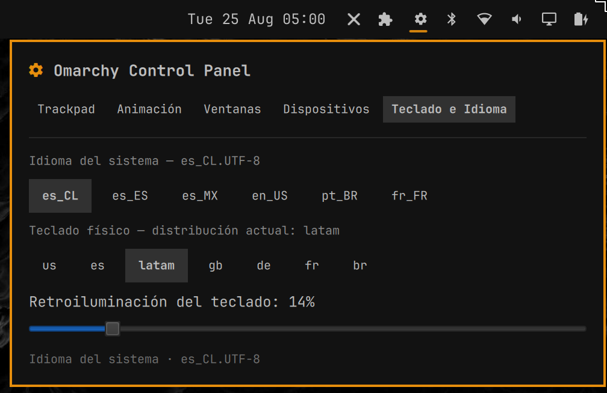

[One-line installer](#one-line-installer)

# Omarchy Control Panel

A system settings panel for **Omarchy / Hyprland**, built as an Omarchy shell plugin (Quickshell/QML). Familiar for users coming from macOS, useful for everyone.



## Features

A quick settings panel summoned from the Omarchy bar. It manages settings without touching `/usr/share/omarchy` and without sudo:

- **Trackpad / Mouse** (tuned for the Apple MTP multi-touch, which Hyprland classifies as a mouse):
  - Tap to click (no physical press)
  - Natural/inverted scrolling (per-device via `natural_scroll` + `scroll_factor`)
  - Inertial scrolling
  - 3-finger swipe to switch workspaces
- **Animations**: system animations, workspace transition, flat pointer acceleration, speed/sensitivity
- **Windows**: inner/outer gaps, font size, animations and workspace distribution
- **Displays**: layout, resolution/refresh/orientation/scale, a color per monitor, and square/rounded/circle/none workspace indicators in the bar. Profiles remember a separate layout for each physical monitor combination using EDID identity rather than connector names.
- **Devices**: keyboard backlight, APFS (macOS disks)
- **QuickView (development)**: native Control Panel overview with live window cards and workspace activation, available from Dev mode.
- **Keyboard & Language**: physical layout, system language
- **Night light**, and more

## Development: unified tooltips

[Omarchy PR #15694](https://github.com/omacom/omarchy/pull/15694) adds shared themed hints and optional interactive cards. This Control Panel integration adds live appearance settings at the end of Windows, translated into all 19 UI languages, and includes the trial in the combined installer below.

## What's new in 0.5

- **Crash-safe scroll inertia**: the always-running bar widget now restores the
  persisted touchpad and physical mouse scroll settings when Quickshell starts.
  A lightweight watchdog repairs live values after delayed Hyprland reloads or
  another component resets them, without requiring the Control Panel window to
  be opened and without reapplying values that are already correct.

## What's new in 0.4

- **Monitor-aware profile layouts**: each profile stores layouts by the exact
  connected monitor combination (`make | model | serial`). Connecting another
  display to the same HDMI/DisplayPort connector no longer applies geometry
  belonging to a different monitor. Existing connector-based profiles remain
  compatible.
- **Reliable display persistence**: confirmed arrangements survive later
  Trackpad, Windows, Keyboard, Device, and profile edits instead of reverting
  when Hyprland reloads. Reordering displays also recalculates numbered
  workspace ranges immediately.
- **Save from every section**: section headers now use one icon/title/action
  pattern, with direct saving to the active custom profile where applicable.
- **Safe `SUPER+W` behavior**: Omarchy's Chromium/Firefox window tags identify
  browsers reliably. Browser windows receive native `Ctrl+W` and close only the
  active tab; other applications close normally. The binding consumes the
  original key press and key-repeat, so terminals receive no escape-sequence
  text while the shortcut is held. It is installed by the always-running bar
  widget at login and repaired automatically after a Hyprland reload, without
  requiring the Control Panel window to be opened.
- **QuickView preview (Dev mode)**: a native workspace/window overview powered by the pinned
  [qs-hyprview](https://github.com/dom0/qs-hyprview) project, with
  Omarchy-specific launcher and integration patches kept separately.
- **Experimental mouse-wheel inertia**: the patched Hyprland installer now
  offers an independent opt-in for physical mouse-wheel acceleration and
  coasting, without changing touchpad behavior.
- **Safe installer reruns**: running the one-liner again updates an existing
  plugin checkout instead of leaving an older installed revision in place.

## Backup and recovery (development)

Backup, Network Devices, QuickView and the SUPER+W browser override are development features hidden by default. Enable **Dev mode** from the Profiles title only when testing them.

The standalone desktop panel includes a Backup page, before Profiles, with
independent configuration and file selections, preview/confirmation, snapshot
history, and restore into an existing empty staging directory outside home.
Configurations use Git commits; plaintext file versions use rsync and hard links
where supported. Optional age public-key encryption uses full encrypted snapshots.

The UI is a four-step wizard: destination, connection/folder, content, review.
Time Capsule offers discovery or manual address entry. SMB and SFTP open the
system file manager for authentication, then verify the actual GVfs mount before
continuing. Passwords never enter the panel. Native folder pickers replace raw
paths; technical output lives under expandable details. Encryption can generate
a recovery key through a save dialog (keep it separate from backup storage).

Git and rsync are required for their respective streams; `age` enables encryption.
Guided network setup uses GIO/GVfs (`gvfs-smb` for SMB and Time Capsule), with
Avahi for discovery. The direct CLI also supports preconfigured rclone SFTP
remotes, but the wizard uses verified mounted folders for all network types.
Legacy Time Capsule firmware may require SMB options unsupported by modern
clients; compatibility must be tested with the actual device, not assumed.

This is not yet an unattended migration wizard or an exact full-home clone:
credential stores and symlinks are excluded, package inventory is saved but
packages are not reinstalled, and staged configurations are not activated.
Review restored data before applying it. See [the backup contract](docs/backup.md)
for exclusions, format, recovery procedure, limitations and fixture-only tests.

## QuickView and experimental scroll patch

QuickView uses [qs-hyprview](https://github.com/dom0/qs-hyprview), authored by
Domenico Martella ([dom0](https://github.com/dom0)), as its overview renderer.
It remains a pinned GPL-3.0 submodule; this plugin owns only its launcher,
gesture/key-binding integration, and Omarchy-specific extensions. See
[THIRD_PARTY_NOTICES.md](THIRD_PARTY_NOTICES.md) for the pinned revision and
license notice.

The Trackpad tab includes **Scroll feel** presets and live sliders for touchpad
scroll acceleration + coast. They are **Dev mode** features because they need a
patched Hyprland that is still under review:

- [hyprwm/Hyprland#16254](https://github.com/hyprwm/Hyprland/pull/16254) — scroll
  acceleration, coast and `scroll_ignore_classes`
- [hyprwm/aquamarine#405](https://github.com/hyprwm/aquamarine/pull/405) — Wayland
  axis source propagation (only needed for nested testing)

### Experimental physical mouse-wheel inertia

The same Dev-mode card includes an opt-in **Apply to mouse wheel** switch. It
enables the experimental acceleration and inertial coast behavior for physical
mouse-wheel input using the patched Hyprland build. It is disabled by default:
enable it only if the wheel feel works well with your mouse and applications.
The switch uses dedicated `input:mouse:scroll_*` options, so it does not change
the touchpad setting and is never written for stock Hyprland.

### One-line installer

Install the Control Panel, the scroll inertia trial and [Omarchy's unified tooltip PR #15694](https://github.com/omacom/omarchy/pull/15694) together:

```bash
curl -fsSL https://raw.githubusercontent.com/avillagran/omarchy-control-panel/0c570866ff8c4a64faab3b53841b19431cc9bd33/bin/install-hyprland-scroll-patch.sh | OMARCHY_PANEL_REF=0c570866ff8c4a64faab3b53841b19431cc9bd33 bash
```

The script, plugin checkout and fallback scroll patches use the same immutable Control Panel commit (`0c570866ff8c4a64faab3b53841b19431cc9bd33`). The tooltip bootstrap verifies Omarchy commit `0cf7154757b4cfa31400df676f4d620c88659b63` from the official Omarchy repository. No moving `main` branch or retagged release is downloaded.

The installer (Arch/Omarchy) performs these steps:

1. Installs the pinned Control Panel and enables its bar widget on the right. An existing clean checkout or non-Git plugin directory is preserved in a durable backup; tracked edits are refused. Dev mode exposes the Scroll feel card.
2. Builds the pinned Quickshell 0.3.1 compatibility runtime and packages the standalone Omarchy tooltip style. It keeps the previous package and selects a tooltip-only copy of the currently installed Omarchy tree, preserving the installed release's other APIs. It requires the official Quickshell 0.3.1 archive and refuses incompatible versions.
3. Builds the existing scroll patch series from pinned upstream Hyprland as a reversible shadow binary at `~/.local/bin/Hyprland`.
4. Adds the existing gated scroll configuration and panel persistence hook. Stock Hyprland never receives unsupported scroll keys.

Save your work and reboot to activate both trials. The installer does not restart the compositor or reboot automatically. Source builds need development packages, disk space and terminal sudo; both CPU architectures use the same implementation. A previously installed tooltip trial is retained rather than claimed as owned by this installer. Legacy inertia installation state must be removed with its original pinned installer before upgrading; the combined installer refuses to guess its ownership or discard its backups.

**Tooltip preferences:** open **Windows**, then scroll to its final section, **Tooltip appearance**. Choose **Theme / Square / Rounded** and **Theme / Transparent / Custom** border color. Custom colors use validated `#RRGGBB` input. After the initial activation, edits apply live to open tooltip hosts without rewriting themes or Hyprland configuration. Theme restores the active theme's geometry, border colors and gradients. The shared file is `~/.config/omarchy/tooltips.json` (or under `XDG_CONFIG_HOME`).

The tooltip integration covers Omarchy and Qt Quick Controls applications. GTK, Qt Widgets, browser content and application-specific tooltip renderers retain their own policies. The runtime compatibility patch is carried by the Omarchy PR; no Hyprland or Quickshell PR is required for tooltips.

**Maintaining the scroll series:** update `HYPRLAND_PIN` and regenerate `patches/hyprland/` together. The installer verifies the series with `git apply --check` and builds only its exact pinned source. The tooltip runtime also requires a reviewed refresh before changing the supported Quickshell version.

To restore the previous configuration and packages installed by this combined trial, then reboot:

```bash
curl -fsSL https://raw.githubusercontent.com/avillagran/omarchy-control-panel/0c570866ff8c4a64faab3b53841b19431cc9bd33/bin/install-hyprland-scroll-patch.sh | OMARCHY_PANEL_REF=0c570866ff8c4a64faab3b53841b19431cc9bd33 bash -s -- --uninstall
```

Rollback restores the original plugin directory and any previous shadow binary, and removes the tooltip trial only if this installer created it. It refuses modified replacement files or an unrelated later Omarchy selection. Personal tooltip preferences are retained.

## Internationalization

- **19 UI languages**: `en`, `es`, `pt`, `fr`, `de`, `it`, `nl`, `pl`, `ru`, `ja`, `ko`, `zh`, `ar`, `tr`, `sv`, `da`, `no`, `fi`, `cs`. The new backup wizard currently has English and Spanish strings; other languages use the English fallback.
- The UI language is **auto-detected** from the system locale (no manual selector needed).
- All UI strings live in `i18n.json`, editable as plain data without touching the QML.
- The **language and keyboard-layout pickers** are searchable dropdowns (`SearchableDropdown`): they list every locale/layout available on the system with type-to-filter.
- **Missing locales**: picking an ungenerated locale shows a one-time command to install a small root-owned helper at `/usr/local/bin/omarchy-control-panel-locale-helper`. After that, "Install & apply" installs the locale in one click. The helper is installed with root ownership and mode 755, so the plugin never executes mutable plugin code as root.

## Technical notes

- **External i18n**: all UI strings live in `i18n.json` (19 fully translated languages). The UI language follows the OS locale.
- **Persistence**: state is saved to `~/.config/hypr/control-panel.lua` (re-applied on Hyprland load) and to the plugin's prefs JSON.
- **No root**: the plugin never writes to `/usr/share/omarchy` and never asks for sudo for normal operation; only essential changes via `hyprctl`. Locale changes use the root-owned `localectl` binary directly (`pkexec localectl set-locale <locale>`). Installing a *missing* locale uses a root-owned helper installed once at `/usr/local/bin/omarchy-control-panel-locale-helper` (pkexec argv, not plugin code). APFS mount/unmount is surfaced as a manual terminal command the user can copy.
- **Security hardening**: all writes to user files (`~/.config/hypr/control-panel.lua`, plugin prefs JSON, and the idempotent `require("control-panel")` line in `~/.config/hypr/hyprland.lua`) go through exclusive `mktemp` temp files in the same directory followed by an atomic `mv -f` — never a predictable `*.tmp` name (which a planted symlink could redirect) and never a `>>` append (the symlink-append vector). Every file/probe read, including inside the write helpers, is byte-capped and FIFO-safe (`timeout 5 head -c 65536`) so a large or malicious file cannot hang or exhaust memory.
- **No state flicker**: the UI syncs from the Lua file (source of truth) on open, avoiding the `hyprctl` read flip-flop on mouse-class devices.

## Installation

```bash
omarchy plugin add https://github.com/avillagran/omarchy-control-panel
```

Update an existing git-managed installation to the latest release with:

```bash
omarchy plugin update io.github.avillagran.omarchy-control-panel --yes
```

Or clone manually into `~/.config/omarchy/plugins/io.github.avillagran.omarchy-control-panel/` and enable it.

## Structure

```
manifest.json        # plugin declaration (id, kinds, entry points)
BarWidget.qml        # bar widget that summons the panel
Panel.qml            # the settings panel
i18n.json            # UI strings in 19 languages
bin/locale-list.sh   # enumerates available system locales for the picker
bin/locale-helper    # root-owned helper for one-click locale install
write-lua-atomic.sh  # atomic, symlink-safe write of control-panel.lua
write-prefs-atomic.sh # atomic, symlink-safe write of plugin prefs
```

## Verification

Before publishing, run the smoke test:

```bash
~/.local/bin/verify-omarchy-control-panel.sh
```

It validates the manifest with `omarchy-plugin-validate`, checks for symlinks, JSON validity, and that the panel loads without errors.

## Screenshots







## License

MIT — see [LICENSE](LICENSE).
