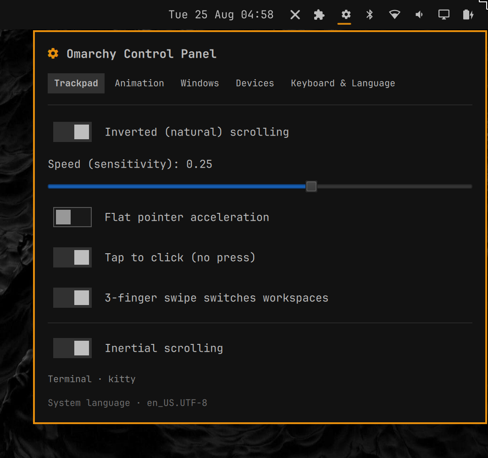
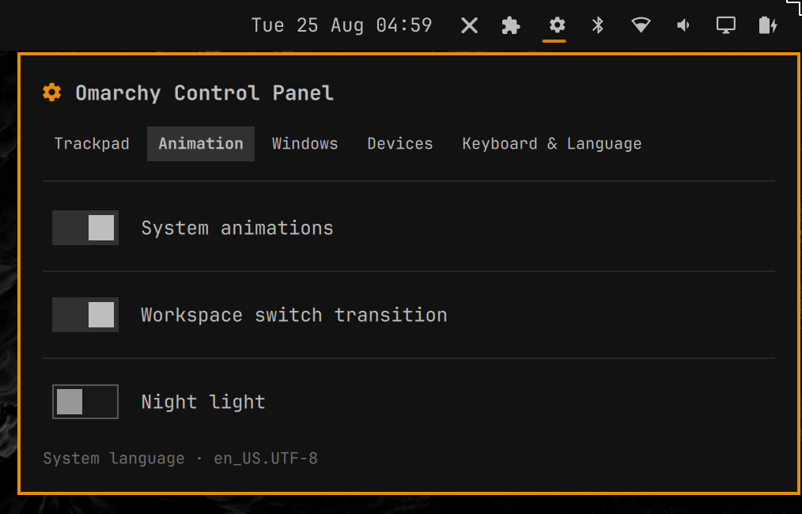
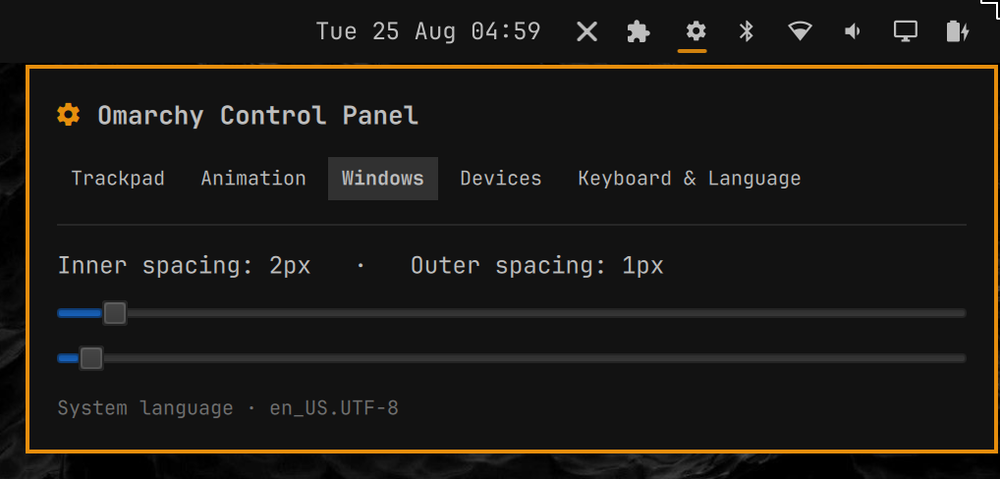
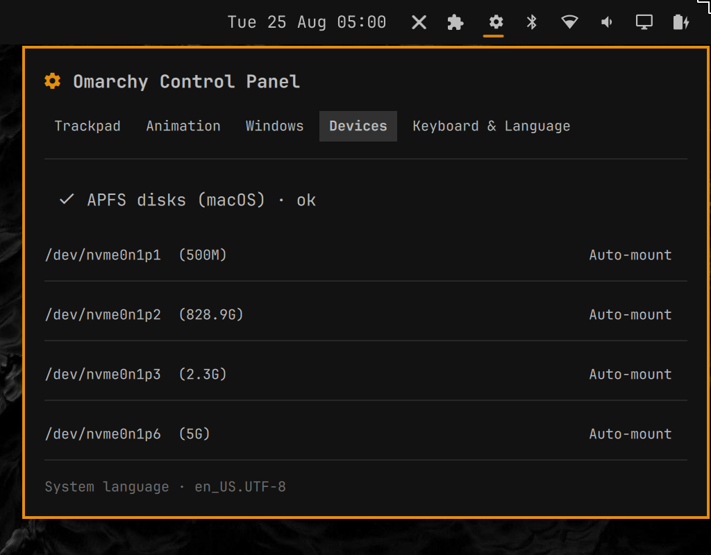
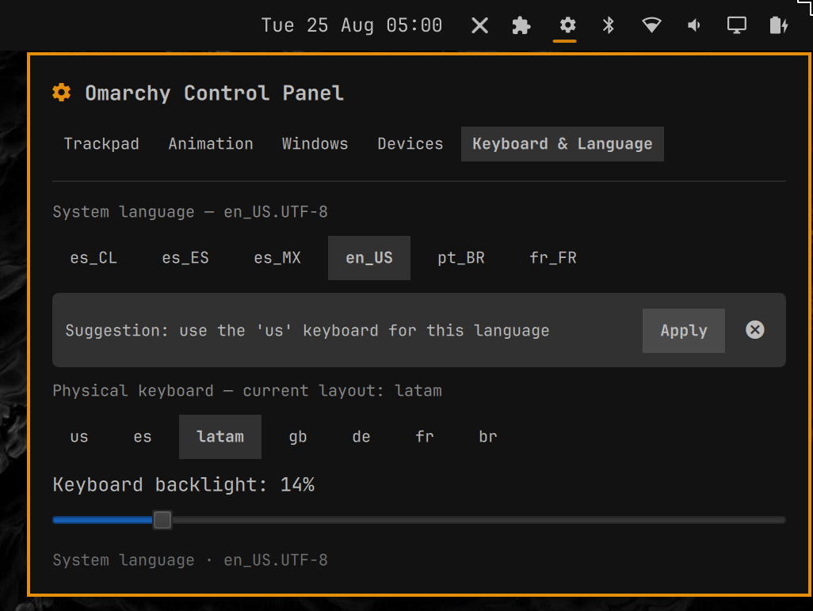
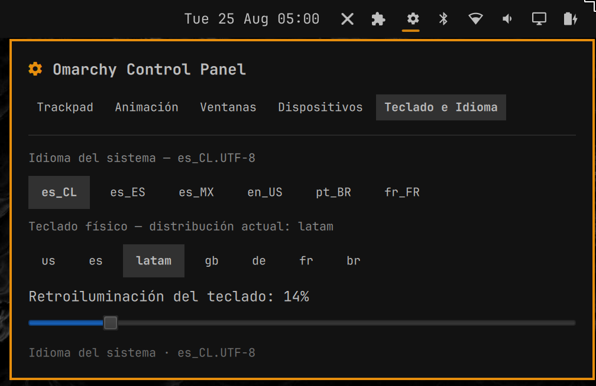

[One-line installer](#one-line-installer)

# Omarchy Control Panel

A system settings panel for **Omarchy / Hyprland**, built as an Omarchy shell plugin (Quickshell/QML). Familiar for users coming from macOS, useful for everyone.

**Scroll inertia, like on macOS:** swipe with two fingers and lift them, and
the page keeps scrolling and slows down. A fast mouse-wheel spin can coast the
same way. It comes from
[omarchy-hyprland-inertia](https://github.com/avillagran/omarchy-hyprland-inertia),
a small Hyprland plugin that loads into the Hyprland Omarchy already runs.
Turn it on in the Trackpad tab, for the touchpad and for the mouse wheel
([details](#scroll-inertia)).



## One-line installer

Run this from a terminal in your Omarchy desktop session. It installs the panel,
enables its widget on the right of the bar and opens the window immediately:

```bash
curl -fsSL https://raw.githubusercontent.com/avillagran/omarchy-control-panel/f6b12ea5a5c6353fdc4f2736df40aa92274fea1a/bin/install.sh | bash
```

The installer downloads an immutable panel revision with Qt 6.12 compatibility.
An existing plugin directory is backed up before replacement; your saved settings
are retained. The panel is ready in the current session without a reboot.

Requires Omarchy with a running Hyprland desktop, Git, Python 3, jq and Quickshell.
To remove the panel, run `omarchy plugin remove io.github.avillagran.omarchy-control-panel`.
Previous plugin copies are preserved under
`~/.cache/omarchy-control-panel/plugin-backups/` (or `$XDG_CACHE_HOME`).
The installer changes the plugin directory and its bar placement; it keeps your
panel preferences. To restore an earlier copy, disable the plugin, move the
current plugin directory aside and move the saved backup to its original path,
then run `omarchy-shell shell rescanPlugins` and enable the plugin again.

## Features

A quick settings panel summoned from the Omarchy bar. It manages settings without touching `/usr/share/omarchy` and without sudo:

- **Trackpad / Mouse** (tuned for the Apple MTP multi-touch, which Hyprland classifies as a mouse):
  - Tap to click (no physical press)
  - Natural/inverted scrolling (per-device via `natural_scroll` + `scroll_factor`)
  - Inertial scrolling for the touchpad and, optionally, the mouse wheel ([omarchy-hyprland-inertia](https://github.com/avillagran/omarchy-hyprland-inertia), [details](#scroll-inertia))
  - 3-finger swipe to switch workspaces
- **Animations**: system animations, workspace transition, flat pointer acceleration, speed/sensitivity
- **Windows**: inner/outer gaps, font size, Omarchy's square single-window and no-gaps toggles, animations and workspace distribution
- **Displays**: layout, resolution/refresh/orientation/scale, a color per monitor, and square/rounded/circle/none workspace indicators in the bar. Profiles remember a separate layout for each physical monitor combination using EDID identity rather than connector names.
- **Devices**: keyboard backlight, APFS (macOS disks)
- **QuickView (development)**: native Control Panel overview with live window cards and workspace activation, available from Dev mode.
- **Keyboard & Language**: physical layout, system language
- **Task Manager (bundled)**: [omarchy-task-manager](https://github.com/avillagran/omarchy-task-manager) pauses memory-hungry apps before the desktop freezes. It stays its own plugin and repo, but the panel ships it **on by default**: Control Panel > Task Manager shows Omi, live CPU/RAM and the activity graph, and its switch turns the whole thing off (watchdog stopped, paused apps thawed, bar icon removed) or back on.
- **OmaBridge**: private links between your devices ([details](#omabridge))
- **Night light**, and more

## Development: unified tooltips

[Omarchy PR #15694](https://github.com/omacom/omarchy/pull/15694) adds shared themed hints and optional interactive cards. This Control Panel integration adds live appearance settings at the end of Windows, translated into all 19 UI languages.

## What's new in 0.5

- **Monitor hotplug without the panel open**: the always-running bar widget
  now resyncs displays when a monitor is connected or disconnected, and once
  at shell start. It restores the active profile's layout for that exact
  monitor combination, places an unsaved monitor flush to the right instead
  of overlapping, redistributes workspace ranges, and keeps
  `control-panel.lua` and the bar's workspace colors in sync. Disconnected
  monitors no longer keep workspace rules for an absent output.

- **Crash-safe scroll inertia**: the always-running bar widget now restores the
  persisted touchpad and physical mouse scroll settings when Quickshell starts.
  A lightweight watchdog repairs live values after delayed Hyprland reloads or
  another component resets them, without requiring the Control Panel window to
  be opened and without reapplying values that are already correct.

## What's new in 0.4

- **Monitor-aware profile layouts**: each profile stores layouts by the exact
  connected monitor combination (`make | model | serial`). Connecting another
  display to the same HDMI/DisplayPort connector no longer applies geometry
  belonging to a different monitor. Existing connector-based profiles remain
  compatible.
- **Reliable display persistence**: confirmed arrangements survive later
  Trackpad, Windows, Keyboard, Device, and profile edits instead of reverting
  when Hyprland reloads. Reordering displays also recalculates numbered
  workspace ranges immediately.
- **Save from every section**: section headers now use one icon/title/action
  pattern, with direct saving to the active custom profile where applicable.
- **Safe `SUPER+W` behavior**: Omarchy's Chromium/Firefox window tags identify
  browsers reliably. Browser windows receive native `Ctrl+W` and close only the
  active tab; other applications close normally. The binding consumes the
  original key press and key-repeat, so terminals receive no escape-sequence
  text while the shortcut is held. It is installed by the always-running bar
  widget at login and repaired automatically after a Hyprland reload, without
  requiring the Control Panel window to be opened.
- **QuickView preview (Dev mode)**: a native workspace/window overview powered by the pinned
  [qs-hyprview](https://github.com/dom0/qs-hyprview) project, with
  Omarchy-specific launcher and integration patches kept separately.
- **Safe installer reruns**: running the one-liner again updates an existing
  plugin checkout instead of leaving an older installed revision in place.

## OmaBridge

The OmaBridge page manages private links between your devices: this device's
identity, publishing it (off by default; T3 Code and/or SSH), one-use
invitations with an optional QR code, pairing from an invitation file,
*Check again* for pairings awaiting approval, approving requests and revoking
paired devices.

A paired device can be allowed to manage this one, either when this device
accepts an invitation that asks for it (the confirmation warns what that
allows and the consent box starts unticked) or later with *Let it manage…*;
*Stop management…* withdraws it at once, and only this device can change it.
On the managing device, *Manage…* opens that device's name, publishing, relay,
pending requests and paired devices; OmaBridge on the managed device decides
what is allowed and records every change.

From *Manage…*, a device with a public address can also host a private relay
for the devices paired with it: OmaBridge suggests a URL from that device's own
certificate, and *Use on my devices…* then moves the devices you manage, and
this one last, to that relay.

A paired device that shares SSH shows *Copy SSH command*: an `ssh` command
that reaches it through OmaBridge (`omabridge connect` as its ProxyCommand),
with no port open on that device. It needs an OmaBridge that supports
`connect`.

*Connection between networks* chooses how this device reaches devices behind
NAT or with private IPs, without opening ports: n0's public relays (the
default), your own relay (for example one hosted with `omabridge relay`) or
direct connections only. Devices that already connect to this one must pair
again after the relay changes.

OmaBridge is independent of this panel and of Omarchy T3 Code: each is just a
front end. The page talks only to `omabridge manage` through
`bin/omabridge-client`, one JSON request on stdin per action, so validation,
secrets and the single `omabridge-serve.service` unit stay in OmaBridge. The
helper uses `omabridge` from `PATH`, `~/.local/bin` or the copy bundled with
Omarchy T3 Code, skipping releases that predate `manage`. Every change of trust
asks for confirmation first. An invitation's path and QR are shown once and
forgotten when their dialog closes or the page is left; *Delete invitation
file* removes the file. Nothing from OmaBridge is logged or saved in the
panel's preferences.

When OmaBridge is missing, or too old to provide `omabridge manage`, the page
asks you to install or update it and changes nothing.

## Backup and recovery (development)

Backup, Network Devices, QuickView and the SUPER+W browser override are development features hidden by default. Enable **Dev mode** from the Profiles title only when testing them.

The standalone desktop panel includes a Backup page, before Profiles, with
independent configuration and file selections, preview/confirmation, snapshot
history, and restore into an existing empty staging directory outside home.
Configurations use Git commits; plaintext file versions use rsync and hard links
where supported. Optional age public-key encryption uses full encrypted snapshots.

The UI is a four-step wizard: destination, connection/folder, content, review.
Time Capsule offers discovery or manual address entry. SMB and SFTP open the
system file manager for authentication, then verify the actual GVfs mount before
continuing. Passwords never enter the panel. Native folder pickers replace raw
paths; technical output lives under expandable details. Encryption can generate
a recovery key through a save dialog (keep it separate from backup storage).

Git and rsync are required for their respective streams; `age` enables encryption.
Guided network setup uses GIO/GVfs (`gvfs-smb` for SMB and Time Capsule), with
Avahi for discovery. The direct CLI also supports preconfigured rclone SFTP
remotes, but the wizard uses verified mounted folders for all network types.
Legacy Time Capsule firmware may require SMB options unsupported by modern
clients; compatibility must be tested with the actual device, not assumed.

This is not yet an unattended migration wizard or an exact full-home clone:
credential stores and symlinks are excluded, package inventory is saved but
packages are not reinstalled, and staged configurations are not activated.
Review restored data before applying it. See [the backup contract](docs/backup.md)
for exclusions, format, recovery procedure, limitations and fixture-only tests.

## QuickView

QuickView uses [qs-hyprview](https://github.com/dom0/qs-hyprview), authored by
Domenico Martella ([dom0](https://github.com/dom0)), as its overview renderer.
It remains a pinned GPL-3.0 submodule; this plugin owns only its launcher,
gesture/key-binding integration, and Omarchy-specific extensions. See
[THIRD_PARTY_NOTICES.md](THIRD_PARTY_NOTICES.md) for the pinned revision and
license notice.

## Scroll inertia

The Trackpad tab has two switches: **Inertial scrolling** for the touchpad and
**Inertia with the mouse wheel**. Either one loads a small Hyprland plugin into
the compositor Omarchy already runs. The plugin lives in its own repository,
[omarchy-hyprland-inertia](https://github.com/avillagran/omarchy-hyprland-inertia),
meant to become an Omarchy package like its titlebars plugin; `native/inertia`
keeps a copy for systems without that package. It does not replace
Hyprland or hook its functions: it listens to touchpad scroll events and, after
the fingers lift, keeps scrolling for up to 0.8 s while slowing down. Moving
the pointer, touching the pad, clicking, typing or changing window stops it.
With the mouse-wheel switch on, a fast spin coasts once the wheel stops; a
single notch or a slow scroll stops exactly where it is, and moving the mouse
does not cut the coast. Browsers and terminals keep their own inertia.

When the `omarchy-hyprland-inertia` package is installed, the switch loads it
and builds nothing. If inertia is already on in Omarchy's own settings, the
panel leaves it alone, so it never scrolls twice. Otherwise
`bin/inertia-plugin` compiles the plugin on your machine the first time
(about 4 s; needs `base-devel`, Hyprland's headers ship with the `hyprland`
package) into `~/.local/state/omarchy/control-panel-inertia/`, outside the
plugin folder. No binary is shipped. A plugin only works with the exact
Hyprland build it was compiled for, so after a Hyprland update inertia pauses
until the next login, then rebuilds itself. If anything fails, Hyprland keeps
running without inertia. The bar widget reloads the plugin at login.

## Internationalization

- **19 UI languages**: `en`, `es`, `pt`, `fr`, `de`, `it`, `nl`, `pl`, `ru`, `ja`, `ko`, `zh`, `ar`, `tr`, `sv`, `da`, `no`, `fi`, `cs`. The new backup wizard currently has English and Spanish strings; other languages use the English fallback.
- The UI language is **auto-detected** from the system locale (no manual selector needed).
- All UI strings live in `i18n.json`, editable as plain data without touching the QML.
- The **language and keyboard-layout pickers** are searchable dropdowns (`SearchableDropdown`): they list every locale/layout available on the system with type-to-filter.
- **Missing locales**: picking an ungenerated locale shows a one-time command to install a small root-owned helper at `/usr/local/bin/omarchy-control-panel-locale-helper`. After that, "Install & apply" installs the locale in one click. The helper is installed with root ownership and mode 755, so the plugin never executes mutable plugin code as root.

## Technical notes

- **External i18n**: all UI strings live in `i18n.json` (19 fully translated languages). The UI language follows the OS locale.
- **Persistence**: state is saved to `~/.config/hypr/control-panel.lua` (re-applied on Hyprland load) and to the plugin's prefs JSON.
- **No root**: the plugin never writes to `/usr/share/omarchy` and never asks for sudo for normal operation; only essential changes via `hyprctl`. Locale changes use the root-owned `localectl` binary directly (`pkexec localectl set-locale <locale>`). Installing a *missing* locale uses a root-owned helper installed once at `/usr/local/bin/omarchy-control-panel-locale-helper` (pkexec argv, not plugin code). APFS mount/unmount is surfaced as a manual terminal command the user can copy.
- **Security hardening**: all writes to user files (`~/.config/hypr/control-panel.lua`, plugin prefs JSON, and the idempotent `require("control-panel")` line in `~/.config/hypr/hyprland.lua`) go through exclusive `mktemp` temp files in the same directory followed by an atomic `mv -f` — never a predictable `*.tmp` name (which a planted symlink could redirect) and never a `>>` append (the symlink-append vector). Every file/probe read, including inside the write helpers, is byte-capped and FIFO-safe (`timeout 5 head -c 65536`) so a large or malicious file cannot hang or exhaust memory.
- **No state flicker**: the UI syncs from the Lua file (source of truth) on open, avoiding the `hyprctl` read flip-flop on mouse-class devices.

## Installation

```bash
omarchy plugin add https://github.com/avillagran/omarchy-control-panel
```

The first time the panel runs it also installs the bundled
[Task Manager](https://github.com/avillagran/omarchy-task-manager) once. Turn
it off in Control Panel > Task Manager and it stays off.

Update an existing git-managed installation to the latest release with:

```bash
omarchy plugin update io.github.avillagran.omarchy-control-panel --yes
```

Or clone manually into `~/.config/omarchy/plugins/io.github.avillagran.omarchy-control-panel/` and enable it.

## Development note: `import QtQuick 6.11`

Every QML file imports `QtQuick 6.11` (and `QtQuick.Window 6.11`), never the
unversioned module. Qt 6.12 added a `QtQuick` `Color` singleton that shadows
`Color` from Omarchy's `qs.Commons`, leaving theme colors `undefined`
(white surfaces, black text, `Cannot read property 'background' of
undefined`). An unversioned `import QtQuick.Window` re-imports the latest
QtQuick and brings the problem back. New files must use the pinned import.

## Structure

```
manifest.json        # plugin declaration (id, kinds, entry points)
BarWidget.qml        # bar widget that summons the panel
Panel.qml            # the settings panel
i18n.json            # UI strings in 19 languages
bin/locale-list.sh   # enumerates available system locales for the picker
bin/locale-helper    # root-owned helper for one-click locale install
write-lua-atomic.sh  # atomic, symlink-safe write of control-panel.lua
write-prefs-atomic.sh # atomic, symlink-safe write of plugin prefs
```

## Verification

Before publishing, run the smoke test:

```bash
~/.local/bin/verify-omarchy-control-panel.sh
```

It validates the manifest with `omarchy-plugin-validate`, checks for symlinks, JSON validity, and that the panel loads without errors.

## Screenshots







## History: retired scroll experiments

Before the inertia plugin, the panel tried to get scroll acceleration and
inertia by patching Hyprland itself. Those upstream pull requests were closed
without merging, and that approach is finished:

- [hyprwm/Hyprland#16254](https://github.com/hyprwm/Hyprland/pull/16254) (scroll
  acceleration, coast and `scroll_ignore_classes`) and
  [hyprwm/aquamarine#405](https://github.com/hyprwm/aquamarine/pull/405)
  (Wayland axis source for nested sessions): closed.
- The **Scroll feel** presets and sliders, and the Dev-mode **Apply to mouse
  wheel** switch, remain behind Dev mode. They only act on a patched Hyprland
  and do nothing on the one Omarchy ships. Mouse-wheel inertia now comes from
  the plugin's own switch.
- The combined scroll and tooltip trial installer is retired. It installed a
  separate Hyprland binary, which could drift from Omarchy's and break login
  after an update. The patches stay in `patches/` for reference only.

To undo that trial installer on a machine that still has it, then reboot:

```bash
curl -fsSL https://raw.githubusercontent.com/avillagran/omarchy-control-panel/25aa630efde26e7b3c1699590b0b839ef1c59e20/bin/install-hyprland-scroll-patch.sh | OMARCHY_PANEL_REF=25aa630efde26e7b3c1699590b0b839ef1c59e20 bash -s -- --uninstall
```

It restores the original plugin directory and any previous Hyprland binary, and
removes the tooltip trial only if this installer created it. It refuses
modified replacement files or an unrelated later Omarchy selection. Personal
tooltip preferences are retained.

## License

MIT — see [LICENSE](LICENSE).
